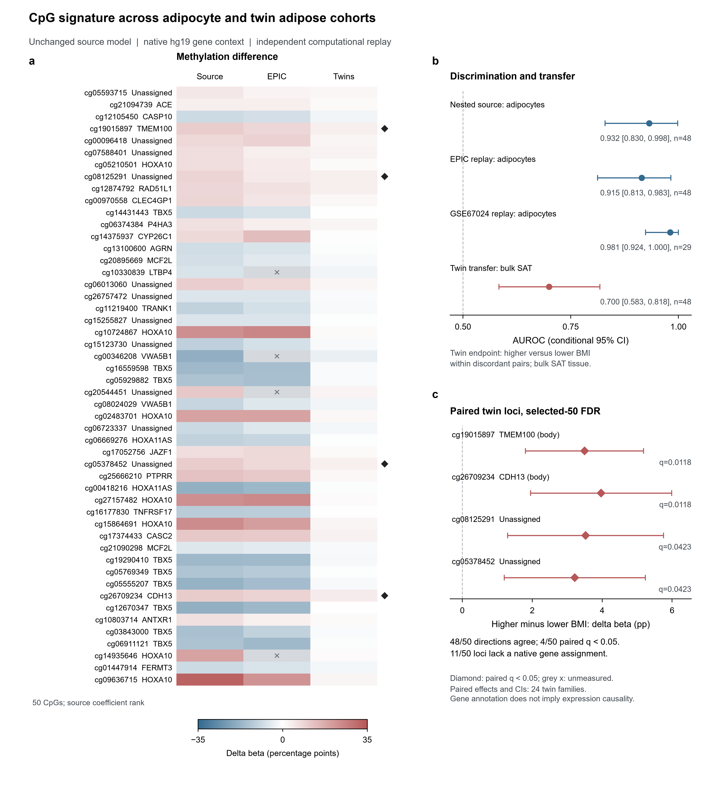

[English](README.md) | **한국어**

# NutriOmics 질환 메틸화 분석

DNA 메틸화 자료로 질환을 분류하고, 분류에 사용된 CpG의 유전자, 조절 영역을 해석하는 연구 코드입니다. 비만 피하지방세포 분석을 중심으로 고혈압과 쌍둥이 지방조직 자료까지 비교했습니다.

[전체 성능표](docs/phase1_extension_receipts_20261003/all_executed_extension_evaluations.tsv) | [비만 분석 결과](docs/obesity_replay_20261003_v1/summary.json) | [CpG, 유전자 그림](docs/twins_figure_20261003_v1/obesity50_twin_gene_context.pdf) | [통합 보고서, 열람 권한 필요](https://github.com/kangk1204/nutriomics-final-report)

## 주요 결과

아래 수치는 2026년 10월 분석과 재실행에서 얻은 결과입니다. AUROC는 질환군과 대조군의 점수를 구분하는 성능이며, 1에 가까울수록 높습니다.

| 분석 | 자료와 평가 대상 | 평가 방법 | AUROC |
|---|---|---|---:|
| 비만 피하지방세포 | GSE222595, 48명: 비만 24명, 대조 24명 | 특징 선택과 조정값 탐색을 내부에서 반복하는 nested 교차검증 | **0.932** |
| 비만 별도 코호트 | GSE67024, 여성 29명: 비만 15명, 대조 14명 | 학습자료에서 확정한 50개 CpG 모델을 그대로 적용 | **0.981** |
| 비만 EPIC 자료 | GSE222595, 48명: 비만 24명, 대조 24명 | 450K 학습 모델의 플랫폼 간 전이 | 0.915 |
| 쌍둥이 지방조직 | GSE68336, 일란성 쌍둥이 24쌍, 48명 | 같은 가족 내 높은 BMI와 낮은 BMI 구분 | 0.700 |
| 고혈압 | GSE193795, 88명: 고혈압 44명, 대조 44명 | ridge, elastic net, 선형 SVM의 nested 비교 중 elastic net | 0.654 |

비만 내부평가의 특징 수는 각 학습 fold 안에서 선택했습니다. 별도 코호트에는 학습자료 전체에서 확정한 50개 CpG 모델을 적용했습니다. GSE67024 결과는 기존 별도 코호트 평가를 재실행한 값으로, 해당 코호트에서 재학습하거나 조정하지 않았습니다. EPIC 자료는 원 연구의 공동 전처리 행렬을 이용했습니다.

쌍둥이 분석은 지방조직 전체에서 가족 내 BMI 차이를 평가합니다. 분리한 지방세포의 비만 분류와 연구 대상, 정답 정의가 다릅니다. 각 평가의 PR-AUC, Brier score, 민감도, 특이도와 고정 예측값의 재표집 신뢰구간은 [전체 성능표](docs/phase1_extension_receipts_20261003/all_executed_extension_evaluations.tsv)에 있습니다.

## CpG와 유전자 해석

50개 CpG에 공식 좌표, 유전자, 전사체와 조절 영역 정보를 연결했습니다. 쌍둥이 자료에서는 가족 내 메틸화 차이와 다중검정 보정값을 함께 제시합니다. 유전자 주석은 해당 CpG의 위치 관계를 설명하며, 발현 조절의 방향은 별도 근거와 함께 해석합니다.



- [전체 50개 CpG 주석표](docs/twins_figure_20261003_v1/annotated_all50_cpg.tsv)
- [가족 내 변화와 유전자 정보](docs/twins_transfer_20261003_v2/paired_cpg_gene_context.tsv)
- [그림 설명과 분석 조건](docs/twins_figure_20261003_v1/legend.md)

## 분석 방법

1. 공개 메틸화 행렬과 시료 정보를 읽고 질환군, 대조군을 확인합니다.
2. 결측값 처리, 특징 선택, 스케일링과 모델 조정을 각 학습 fold 안에서 수행합니다.
3. 학습에서 제외된 시료의 예측을 모아 내부 성능을 계산합니다.
4. 확정한 모델을 별도 코호트에 적용하고, 코호트별 예측값과 성능을 저장합니다.
5. CpG 주석과 변화 방향을 연결해 생물학적 해석 자료를 만듭니다.

고혈압의 전고혈압 44명은 주 학습, 조정에서 제외하고 보조 평가에 사용합니다. 반복측정과 쌍둥이 자료는 참가자, 가족 단위를 반영합니다. 신뢰구간의 재표집 단위와 전처리 조건은 각 결과 파일에 기록했습니다.

## 결과 확인과 재실행

| 확인할 내용 | 파일 |
|---|---|
| 비만 분석 조건 | [protocol.json](docs/obesity_replay_20261003_v1/protocol.json) |
| 내부평가 예측값 | [source_repeated_oof.tsv](docs/obesity_replay_20261003_v1/source_repeated_oof.tsv) |
| 별도 코호트 예측값 | [gse67024_predictions.tsv](docs/obesity_replay_20261003_v1/gse67024_predictions.tsv) |
| 비만 재실행 코드 | [replay_obesity_primary.py](scripts/replay_obesity_primary.py) |
| 고혈압 모델 비교 | [run_extension_htn_grid.py](scripts/run_extension_htn_grid.py) |
| 쌍둥이 분석 | [evaluate_twins_transfer.py](scripts/evaluate_twins_transfer.py) |
| 초기 고혈압 평가, LOOCV | [분석 요약](docs/validation/SUMMARY.md) |
| 학습자료 재평가 | [분리된 진단 결과](docs/trainset_20261003/SUMMARY_KO.md) |

Python 3.12 이상에서 설치합니다.

```sh
python -m pip install -e ".[test,annotation]"
nutriomics-methylation --help
python -m pytest -q
```

고혈압 기본 분석은 다음 순서로 실행합니다. 자료 내려받기와 학습에는 저장공간과 계산 시간이 필요합니다.

```sh
nutriomics-methylation fetch
nutriomics-methylation prepare
nutriomics-methylation train --cores 12 --spaces common full --methods nested5 loocv
nutriomics-methylation evaluate --bootstrap-replicates 1000
nutriomics-methylation export
```

비만, 쌍둥이 재실행은 위 개별 스크립트와 해당 분석 조건 파일을 사용합니다. 원자료, 학습 모델은 연구 데이터 저장소에 보관하며, 이 저장소에는 코드, 분석 조건, 요약표와 예측값을 제공합니다.

## 자료 출처와 사용 조건

메틸화 자료는 NCBI GEO의 GSE222595, GSE67024, GSE68336, GSE193795와 GSE42774에서 확보했습니다. 저장소 이름의 `htn`은 초기 고혈압 분석에서 유래했으며, 현재는 여러 질환의 메틸화 평가를 포함합니다. 코드의 이용조건은 [LICENSE](LICENSE)를, 원자료는 각 제공기관의 이용조건을 따릅니다.

코드는 [MIT 라이선스](LICENSE)로 제공합니다. 외부 자료와 모델의 출처 및 이용조건은 [데이터와 소프트웨어 이용 안내](DATA_LICENSES.md)에 정리했습니다.
